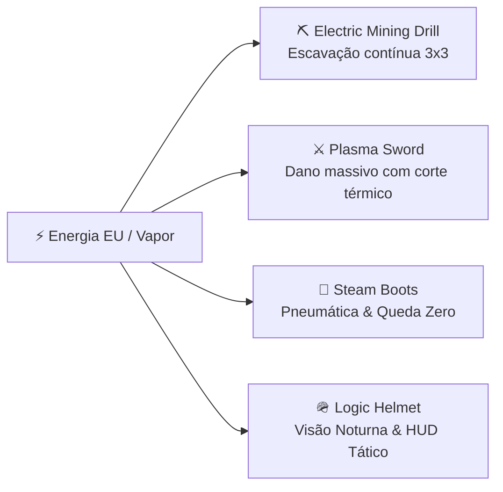

# 🛡️ Exerion: Tools, Equipment & Materials Catalog

---

## 🛠️ Specialized Hand Tools

### 1. The Wrench (`net.exerion.item.WrenchItem`)
- **Primary Function:** Essential wrench for industrial factory builders.
- **Rotate Blocks:** Right-click on any machine or cable to cycle its facing direction.
- **Safe Machine Dismantling:** **Shift + Right-Click** on any Exerion machine to instantly pick it up as an item **preserving its internal inventory, energy buffer, and configuration**. Avoids breaking complex machinery with regular pickaxes.

### 2. The Era Scanner (`net.exerion.item.EraScannerItem`)
- **Block Inspection:** Right-click on any block in the world to display its required civilization era in chat.
- **Player Status:** Right-click in the air to display your current technological tier and percentage of requirements gathered.
- **Recharge Mechanism:** Consumes charge per scan. Recharged by inserting it into an active **Steam Turbine**.

### 3. Exerion Guidebook (`net.exerion.item.ExerionGuideBookItem`)
- An interactive in-game manual. Features tabbed navigation across all 10 eras, item requirements, machine operating manuals, and danger alerts.

---

## ⚔️ High-Tier Weapons & Power Tools



| Item | Technological Era | Special Functionality |
|:---|:---:|:---|
| **Steam Boots** | Era 4 (Steel/Steam) | Pneumatic steam shock absorbers. **Completely eliminates fall damage** and grants a high pneumatic jump boost on release. |
| **Logic Helmet** | Era 6 (Digital) | Digital computer overlay. Grants perpetual **Night Vision** without screen glare and detects hostile entities through walls. |
| **Electric Chestplate** | Era 5 (Industrial) | Electrified armored vest. Absorbs kinetic and explosive damage by dissipating incoming shock into stored battery energy. |
| **Electric Mining Drill** | Era 8 (Quantum) | High-speed excavation drill. Destroys stone, deepslate, and ores almost instantly with zero tool wear when supplied with EU. |
| **Plasma Sword** | Era 8 (Quantum) | Superheated plasma edge. Deals massive physical and fire damage, igniting targets and penetrating heavy armor. |
| **Exerion Suit (Full Set)** | Era 9 (Cosmic) | End-game power suit offering complete immunity to lava, drowning, radiation, and kinetic impacts. |

---

## ⚙️ Machine Upgrades

Insert these upgrade cards into the upgrade slots of machines (Electric Crusher, Compressor, Alloy Smelter, Electric Furnace):

- **Speed Upgrade:** Overclocks internal cycle clocks, speeding up processing by **$+25\%$ per card** (consumes additional EU proportionally).
- **Efficiency Upgrade:** Optimizes energy dissipation, reducing required EU/t or torque by **$-15\%$ per card**.

---

## 💎 Materials, Components & Intermediates

```mermaid
graph TD
    Raw["Raw Exerion"] --> Ingot["Exerion Ingot"]
    Ingot --> Plate["Exerion Plate (Gear Press)"]
    Ingot --> Rod["Exerion Rod"]
    Plate --> Gear["Exerion Gear"]
    
    Coal["Coal"] + Iron["Iron"] --> SteelComp["Steel Compound"]
    SteelComp --> SteelIngot["Steel Ingot (Blast Furnace / Smelter)"]
    
    Raw + Redstone["Redstone"] --> Core["Exerion Core"]
    Copper["Copper Plate"] + Silicon["Quartz / Logic"] --> Circuit["Circuit Board"]
    Circuit + Gold["Gold"] --> Logic["Logic Chip"]
```

1. **Exerion Ore & Deepslate Exerion Ore:** Found deep underground ($Y = -64$ to $Y = 16$). Emits a subtle faint glow.
2. **Raw Exerion:** Raw unrefined cluster mined from Exerion veins.
3. **Steam Crystal:** Compressed superheated steam trapped in crystal lattices. The universal fuel for steam turbines and pneumatic equipment.
4. **Steel Compound:** Pre-smelted metallurgical mixture of iron dust and pulverized coal dust.
5. **Circuit Board & Logic Chip:** Silicon logic components essential for digital terminals and high-tier energy grids.
