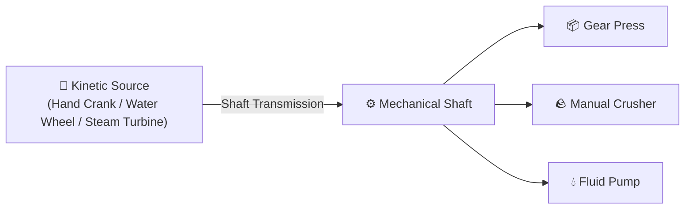
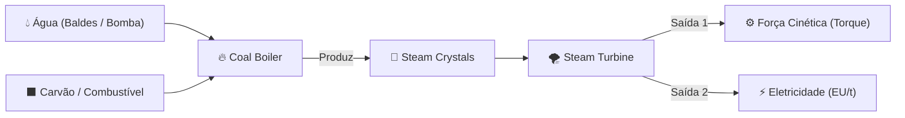
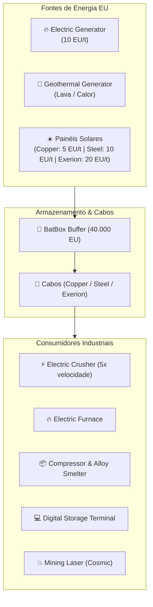

# ⚡ Exerion: Machines, Energy & Power Systems

**Exerion** features a hybrid, multi-tier energy architecture blending rotational mechanical force, thermodynamic steam pressure, and electrical grid management.

---

## ⚙️ 1. Rotational / Kinetic Power (*Force Mécanique - FM*)

Kinetic power is the lifeblood of early automation (Eras 1–3). Machines require physical torque to grind ores and press metal ingots into plates and gears.

### Kinetic Sources (`IFMSource`)
- **Hand Crank:** Player-operated manual crank. Shift-right-click to provide temporary kinetic torque.
- **Water Wheel:** Generates passive, continuous kinetic energy from adjacent flowing water streams.
- **Steam Turbine:** Industrial-grade kinetic driver. Spins at high RPM when fed Steam Crystals, driving large factory shafts.

### Kinetic Consumers (`IFMConsumer`)
- **Gear Press:** Presses metal ingots into **Plates** and **Gears**. Using a Gear Press doubles resource efficiency compared to crafting recipes on a crafting table.
- **Manual Crusher:** Crushes mined ores into dusts (**Ore Doubling**). Includes a **$25\%$ bonus chance** to yield secondary byproduct dusts!

---

## 💨 2. Thermodynamic Steam System

Steam bridges the gap between mechanical gears and electrical circuits (Era 4).

### Coal Boiler (`net.exerion.block.CoalBoilerBlock`)
- **Inputs:** Liquid water (via buckets or automated pipe/pump) and combustible fuel (Coal, Charcoal).
- **Output:** Condenses superheated steam into stable **Steam Crystals**.
- > [!CAUTION] Explosive Warning!
  > If a Coal Boiler is allowed to reach operating temperature without water in its internal reservoir, **it will detonate**, destroying adjacent blocks and damaging nearby players! Always prime with water before stoking the fire!

### Steam Turbine (`net.exerion.block.SteamTurbineBlock`)
- Consumes **Steam Crystals** to simultaneously output:
  1. Mechanical torque to connected shafts.
  2. Electrical Units (EU) to adjacent power cables.
- **Recharging Station:** Shift-click an **Era Scanner** inside the turbine chamber to recharge its internal energy cells.

---

## ⚡ 3. Electrical Units (EU) & Power Grid

The standard power currency for modern and digital machinery (Eras 5–9).

### Generation Sources
- **Electric Generator:** Burns solid combustibles to output a steady **$10\text{ EU/t}$**. Contains an internal buffer of $4.000\text{ EU}$.
- **Geothermal Generator:** Extracts thermal energy directly from adjacent lava pools or magma blocks. Clean, perpetual, and silent.
- **Solar Panels:**
  - **Copper Solar Panel:** Basic daylight harvester ($5\text{ EU/t}$).
  - **Steel Solar Panel:** High-efficiency photovoltaic cells ($10\text{ EU/t}$).
  - **Exerion Solar Panel:** Superconducting solar array ($20\text{ EU/t}$).
  - *Condition:* Must have an unobstructed line of sight to the open sky. Inactive during night and thunderstorms.

### Transmission & Storage
- **BatBox:** Compact battery accumulator with an internal buffer of $40.000\text{ EU}$. Accepts power on input faces and routes current through output sockets.
- **Cables:**
  - `Copper Cable`: Basic transmission with moderate line resistance.
  - `Steel Cable`: Industrial-capacity power trunk.
  - `Exerion Cable`: Zero-resistance superconductor for high-voltage quantum systems.

---

## 🌌 4. Quantum & Digital Machinery

- **Digital Storage Terminal:** An advanced all-in-one inventory storage computer. Indexes and aggregates connected chests into a single searchable grid GUI.
- **Frequency Ender Chest:** Transmits items instantly across dimensions and infinite distances. Entangled on specific user-configured frequency channels.
- **Frequency Ender Tank:** Transmits high-volume fluids (water, lava, steam) across dimensions on quantum frequencies.
- **Mining Laser:** The zenith of cosmic engineering. Fires a sustained beam that excavates large quarry volumes, dropping crushed ores directly into your inventory or connected mechanical chutes.
